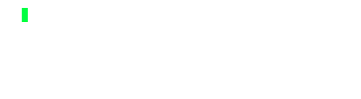

 

---

## About me

Hi, I'm **Nguyễn Duy Hưng**, an Information Security student (class of 2024) at the University of Information Technology, VNU-HCM.

I build autonomous multi-agent systems that **find, verify and exploit real vulnerabilities**, and I dig into the layers below them: Linux kernel packet filtering and raw disk forensics.

- Hunting zero-days in C/C++ libraries with LLM agents and fuzzing
- Agentic fuzzing and automated CTF solving
- Kernel and low-level security with eBPF/XDP, sector-level and MFT forensics
- Naming my main projects after the megacorps of Cyberpunk 2077

---

## The Cyberpunk Megacorp Series (AI x Security)

| Project | Stack | What it does |
| --- | --- | --- |
| [**Militech**](https://github.com/Hugnd-UIT/Militech) | Python | Multi-agent system that hunts and exploits vulnerabilities across entire repositories |
| [**Arasaka**](https://github.com/Hugnd-UIT/Arasaka) | Python, C/C++ | Autonomous multi-agent fuzzing framework for C/C++ repositories |
| [**Kang-Tao**](https://github.com/Hugnd-UIT/Kang-Tao) | Python | Automated CTF challenge solver powered by LLMs |
| [**Budget-Arms**](https://github.com/Hugnd-UIT/Budget-Arms) | Python, C (eBPF/XDP) | Hybrid ML and LLM agent framework for DDoS defense |
| [**Trauma-Team**](https://github.com/Hugnd-UIT/Trauma-Team) | C, Python | Windows disk recovery for NTFS and FAT12/16/32, mixing deterministic forensics with an LLM agent |

<b>Militech</b>: repository-level vulnerability hunting

 

- **Phase 0, static graph and dedup filter:** builds the call graph `G = (V, E)` with `graphify`, drops non-production code (`tests/`, `fuzz/`, `mock/`) and scores every taint call-flow with a heuristic risk score `S(f)`.
- **Phase 3, adversarial debate FSM:** up to 3 rounds between a `Vuln Analyzer` (hypothesis, code evidence, expected oracle) and an independent `Vuln Debator`. Findings end up in `approved/`, `disputed/` or `rejected/`.
- **Phase 4, empirical PoV execution oracle:** a `PoV Generator` and a `PoV Verifier` write real proof-of-vulnerability code and run it in a Linux sandbox with ASan and UBSan, which can promote `disputed/` findings.
- Retriever benchmarked on **VulnGym**.

<b>Arasaka</b>: autonomous C/C++ fuzzing

 

- Agents read a library's source, generate dozens of C++ fuzz harnesses and orchestrate multi-core **AFL++** campaigns with ASan and UBSan.
- **Zero-FP architecture with fault ownership and trust boundary:** harmless UBSan noise (such as `1 << 31`) is filtered out. Harness mistakes go to `crash_reports/harness_bug/` so the agent can fix them quietly, and real library faults go to `crash_reports/lib_bug/` as CVE candidates.
- Field-tested on `bzip3` (74 fuzzers and 76 harnesses running for 24h), `mpack`, `libucl`, `libxls` and `simdjson`.

<b>Kang-Tao</b>: end-to-end CTF solving

 

- Autonomous agents solve Capture The Flag challenges without human help: read the task, analyze, exploit inside Docker containers, use Firecrawl for research and submit the flag.
- Six specialized AI modules cooperate in one closed loop.

<b>Budget-Arms</b>: DDoS defense from kernel to LLM

 

- **Data plane:** high-speed packet filtering inside the Linux kernel with eBPF/XDP (`prevent/xdp.c`), Kernel 5.15+ or WSL2.
- **Inference engine:** dual traffic classification with supervised **XGBoost** and unsupervised **Isolation Forest**.
- **Cognitive forensics:** an asynchronous ReAct LLM agent with RAG investigates incidents, attributes the attack source and remediates false positives automatically.

<b>Trauma-Team</b>: recovering deleted data from disk images

 

- **Layer 1, deterministic sector parser:** reads `.img` files from Sector 0 (VBR), detects NTFS, FAT12, FAT16 or FAT32, parses `$MFT` (`$FILE_NAME` 0x30, `$DATA` 0x80 resident and non-resident data runs) and the RDET/FAT tables to rebuild deleted directory trees.
- **Layer 2, LLM cluster stitching agent:** when a deleted source file (`.c`, `.cpp`, `.cs`, `.py`) on FAT has a zeroed cluster chain and is fragmented, the agent stitches the scattered clusters back together.
- **Layer 3, code integrity verifier:** checks syntax with AST parsers (`ast.parse`, `tree-sitter`, compiler checks) and self-heals when a check fails.

---

## Vulnerability research

Independently discovered and verified, each with a working proof of vulnerability confirmed under ASan.

| Library | Version | Findings | Highlights |
| --- | --- | --- | --- |
| **cJSON** | v1.7.16 | 6 zero-days | `overwrite_item` ignores `cJSON_IsReference` on root replace, leading to heap use-after-free and double-free (**CVSS 9.8 Critical**). `sort_list` breaks the `head->prev` tail invariant, causing silent data loss and a heap UAF write (**CVSS 8.2 High**). Also NULL dereferences in `cJSONUtils_strdup` and `pointer_encoded_length` (**CVSS 7.5 High**), plus infinite loop or double-free in `add_item_to_array` and a cross-tree aliasing UAF in `cJSON_ReplaceItemViaPointer`. |
| **libxls** | v1.6.4 (`34c7cc6`) | 3 bugs in BIFF8 parsing | Heap buffer overflow write of 255 bytes in `xls_getCSS` via unchecked `strcat` (**CVSS 8.8 High**, CWE-122). Global out-of-bounds read in `xls_getColor` (**5.3 Medium**). Heap buffer overflow read in `xls_parseWorkSheet` (**3.1 Low**). All reproducible with a C PoC and a crafted `.xls`. |
| **libucl** | <= 0.10.0 (`c3580720`) | 3 heap use-after-free | `ucl_hash_destroy` reads freed memory after `ucl_object_merge(copy=false)` because two `ucl_hash_t` tables share an intrusive linked-list pointer (**CVSS 7.5 High**, CWE-416). Affects projects that embed libucl, such as FreeBSD pkg and Rspamd. |

---

## Academic projects

**DySec** ([`ML-Based-Malicious-Package-Detection-NT521`](https://github.com/Hugnd-UIT/ML-Based-Malicious-Package-Detection-NT521))

Dynamic analysis system that detects malicious PyPI packages with eBPF kernel and user-level probes.

- 36 real-time behavioral features collected during package installation: syscalls, network and directory access
- Dataset of **14,271** Python packages, **7,127** of them malicious
- **96%** accuracy, inference latency under **0.5s**, and **78.65%** fewer false negatives than static analysis
- Found **6 real-world malicious packages**, all removed by PyPI

---

## Toolbox

---

## Contact

- GitHub: [@Hugnd-UIT](https://github.com/Hugnd-UIT)
- Email: [hungnd.attt2024@gmail.com](mailto:hungnd.attt2024@gmail.com)

`> whoami` &nbsp;->&nbsp; **Agentic security dev**

